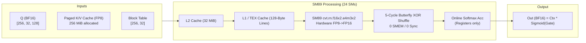

# Sparse Paged GQA FP8 Kernels — SM89

This repository contains synthetic sparse Grouped-Query Attention (GQA) benchmarks for NVIDIA Ada Lovelace GPUs (compute capability 8.9). It includes optimized and baseline CuTe DSL kernels, a Triton implementation, a raw CUDA C++ kernel, and a Mojo / MAX implementation.

## Workload

- 256 requests, 32 query heads, 8 KV heads, and head dimension 128
- Top-K 512, page size 16, 32 physical pages per request
- FP8 E4M3FN K/V cache; BF16 query, gate, and output tensors
- Fused sigmoid gate and online softmax
- PyTorch reference environment: 2.14.1+cu130 (CUDA 13.0 build)

Grouped kernels launch 2,048 CTAs at this size (one per request/KV-head); baseline CuTe and Triton launch 8,192 (one per request/query-head). The four fused GPU implementations request about 1 GiB of logical K/V payload per invocation; the eager PyTorch baseline gathers about 256 MiB and reuses it across query heads. The cache holds exactly the pages needed for Top-K. Current Nsight Compute captures report 57.81–98.86% achieved occupancy across the five fused GPU kernels; old 64-request timing figures do not describe this configuration.

All six implementations report validation against either the shared PyTorch reference or an independent closed-form constant-input reference. The PyTorch eager baseline, CuTe, and Triton use randomized data; CUDA and Mojo use a constant-input check. The source also contains prior 64-request measurements and saved Nsight Compute captures. See [`wrtiteup.md`](wrtiteup.md) for their provenance and profiling details.

## Current run

Run `python3 run_all.py` for the six-implementation comparison, including the eager PyTorch baseline. In the recorded run, the measured order was raw CUDA, Triton, optimized CuTe, baseline CuTe, and PyTorch eager; Mojo is unranked because it reports enqueue-plus-sync wall time. The write-up includes measured rates, logical K/V payload estimates, and Nsight profiles with caveats in [`wrtiteup.md`](wrtiteup.md).


The write-up also includes a [K/V movement diagram](charts/kv_data_movement.png) and [Nsight Compute counter chart](charts/ncu_utilization.png).

## Repository files

- `sm89_cutedsl.py` — optimized CuTe DSL kernel, one CTA per request/KV head
- `backup.py` — baseline CuTe kernel, one CTA per request/query head
- `sm89_cuda.cu` — CUDA C++ implementation
- `sm89_mojo.mojo` — Mojo / MAX implementation
- `sm89_torch.py` — vectorized eager PyTorch baseline
- `sm89_triton.py` — Triton implementation with PyTorch reference validation
- `charts/generate_charts.py` — regenerates the comparison figures from the reported run
- `run_all.py` — runs all six implementations and prints a comparison table
- `qsa_sm89_*.ncu-rep` — saved Nsight Compute captures for the original CuTe/CUDA implementations
- `qsa_sm89_*_256.ncu-rep` — focused Nsight Compute profiles for the fused GPU kernels at the current 256-request shape
- [`wrtiteup.md`](wrtiteup.md) — implementation details, profiling notes, and measurement caveats

## Run

Run all implementations and print a comparison table:

```bash
python3 run_all.py
```

Or run individual implementations:

```bash
python3 sm89_cutedsl.py
python3 backup.py
cudarun sm89_cuda.cu
mojo sm89_mojo.mojo
```

The CUDA command above uses the local `cudarun` helper. To compile directly with NVCC, use:

```bash
nvcc -O3 -arch=sm_89 -lineinfo sm89_cuda.cu -o sm89_cuda
./sm89_cuda
```


## Architecture & Kernel Execution Models

The implementations in this benchmark demonstrate how architectural choices—such as CTA grid granularity, reduction mechanism, and memory coalescing—drastically impact GPU throughput on Ada Lovelace (SM89). Detailed Mermaid and ASCII schematics are documented in [`wrtiteup.md`](wrtiteup.md#architectural-deep-dive-attention-kernel-and-memory-flow).

### Attention Dataflow & Memory Hierarchy



### Execution Archetypes Comparison

```
+---------------------------------------------------------------------------------------------------+
| Archetype 1: Grouped Warp-Specialized (Raw CUDA, Optimized CuTe DSL, Mojo)                        |
|   - Grid: [256, 8, 1] = 2,048 CTAs  |  CTA: 128 threads (4 warps)                                 |
|   - Mapping: 1 CTA per (request, kv_head). Each warp processes 1 full Q-head (128 dims).          |
|   - Reduction: Intra-warp butterfly reduction (5 shuffles across registers).                     |
|   - Synchronization: 0 Shared Memory, 0 __syncthreads() barriers.                                |
|   - Latency: 2.1641 ms (CUDA) / 4.4411 ms (CuTe) | Achieved Occupancy: ~95%                       |
+---------------------------------------------------------------------------------------------------+
| Archetype 2: Baseline Cross-Warp Cooperative (Backup CuTe DSL)                                    |
|   - Grid: [256, 32, 1] = 8,192 CTAs  |  CTA: 128 threads (4 warps)                                |
|   - Mapping: 1 CTA per (request, q_head). All 4 warps cooperate on single 128-dim head.           |
|   - Reduction: Warp shuffles + Shared Memory (4 floats) + 2 __syncthreads() barriers per token.   |
|   - Latency: 15.4536 ms | Achieved Occupancy: 98.86% (High barrier stall overhead)                |
+---------------------------------------------------------------------------------------------------+
| Archetype 3: 2D Vector Tile (Triton)                                                              |
|   - Grid: 8,192 programs  |  num_warps = 4 (128 threads)                                          |
|   - Mapping: 1 program per (request, q_head) looping over 32-token tiles (BLOCK_N = 32).           |
|   - Register Budget: 72 regs/thread | Achieved Occupancy: 57.81% | SM Throughput: 86.31%          |
|   - Latency: 2.4420 ms (Second fastest implementation)                                            |
+---------------------------------------------------------------------------------------------------+
| Archetype 4: Multi-Pass Framework Dispatch (PyTorch Eager)                                        |
|   - Gather unique K/V rows once per KV head (256 MiB logical payload, ~1.5 GiB FP32 temps).       |
|   - Sequence of separate ATen kernels: Index gather -> Matmul QK -> Softmax -> Matmul PV -> Gate.  |
|   - Latency: 31.0188 ms (CUDA events)                                                             |
+---------------------------------------------------------------------------------------------------+
```

### SM89 Native 128-Byte Memory Coalescing

```
 Lane  0: loads FP8 dims [  0..  3] (4 bytes) ──┐
 Lane  1: loads FP8 dims [  4..  7] (4 bytes)   │
 ...                                            ├──> 32 lanes x 4 bytes = 128 contiguous bytes
 Lane 31: loads FP8 dims [124..127] (4 bytes) ──┘    (Exact match to SM89 native cache line!)
```

## Kernel organization

The optimized CuTe and CUDA versions launch one 128-thread CTA per `(request, KV head)`. Its four warps each handle one query head in that GQA group, and each warp reduces a 128-dimensional dot product with five butterfly shuffles. The baseline instead launches one CTA per query head and uses shared-memory cross-warp reduction. The Mojo version uses the grouped launch mapping but has its own host-timed benchmark path.

