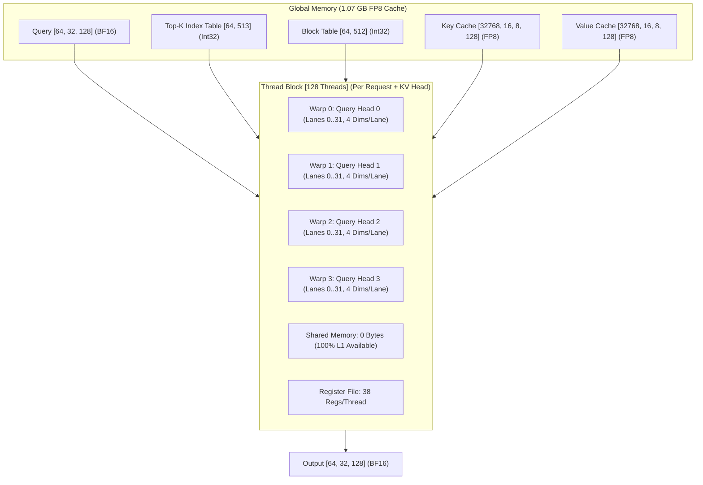

# TECHNICAL REPORT: OPTIMIZED QSA FP8 GQA KERNEL FOR SM89 HARDWARE

## 1. Document Overview

This document describes the optimized QSA (Quick Sparse Attention) kernel.
The kernel uses the NVIDIA CuTe DSL compiler.
The kernel targets the NVIDIA Ada Lovelace architecture (Compute Capability 8.9).
The test hardware is the NVIDIA GeForce RTX 4060 Laptop GPU.
This document follows the rules of the ASD-STE100 specification.

```
Reference: QSA-SM89-STE100-002
Date: 2026-10-21
Hardware Target: SM89 (NVIDIA Ada Lovelace, RTX 4060 Laptop GPU)
Language Standard: ASD-STE100 (Simplified Technical English)
Compiler: nvidia-cutlass-dsl 4.8.1 / CUDA 13.4
Profiling Tool: NVIDIA Nsight Compute (NCU)
```

---

## 2. Technical Description of the Kernel

### 2.1 Purpose and Operation

The kernel executes sparse paged grouped-query attention (GQA).
The kernel operates during the decode phase of large language models.
Each CUDA thread block processes one grouped-query attention tile for one request:
* Grid dimensions: `[NUM_REQUESTS, NUM_KV_HEADS, 1]` (512 thread blocks).
* Block dimensions: `[128, 1, 1]` (128 threads, 4 warps).
* Each warp of 32 threads processes one query head in the GQA group (`GROUP_SIZE = 4`).
* Each thread in the warp processes four coordinates of the 128-dimensional head vector:
  $$\text{Thread } l \implies [4l, 4l+1, 4l+2, 4l+3], \quad l \in [0, 31]$$
* All four warps in the thread block read the same Key and Value cache vectors.
* This sharing reduces global memory traffic for Key and Value tensors by four times ($4\times$).

### 2.2 Memory and Data Formats

The kernel uses three memory formats:
1. Query vectors ($Q$) use 16-bit brain floating-point format (`bfloat16`).
2. Gate vectors use 16-bit brain floating-point format (`bfloat16`).
3. Key ($K$) and Value ($V$) cache tensors use 8-bit floating-point format (`fp8_e4m3fn`).

The cache uses a paged table layout:
* Each physical block contains 16 tokens (`PAGE_SIZE = 16`).
* A top-K index buffer stores the active tokens for each request (`TOPK = 512`).
* Maximum context capacity per request is 8,192 tokens (`MAX_PAGES = 512`).
* Total physical cache stores 32,768 blocks (524,288 tokens, 1.07 GB FP8 footprint).



### 2.3 Mathematical Sequence

For each active token in the top-K list, each warp executes these steps:
1. Read the token identifier from the index buffer.
2. Read the physical page identifier from the block table.
3. Compute the memory address of the Key vector.
4. Load four 8-bit FP8 Key elements into registers with 128-byte coalescing.
5. Multiply the four Query elements by the four Key elements:
   $$\text{partial} = \sum_{i=0}^{3} Q_{4l+i} \times K_{4l+i}$$
6. Sum the partial values across all 32 lanes of the warp using five butterfly shuffles:
   $$\text{score} = \left(\sum_{t=0}^{31} \text{partial}_t\right) \times \text{softmax\_scale}$$
7. The reduction uses zero shared memory and zero block synchronization barriers.
8. Update the running maximum value ($m$) and running normalizer ($l$) in registers.
9. Load four 8-bit FP8 Value elements into registers.
10. Accumulate the Value elements into the four running accumulator registers.
11. After the token loop, multiply the accumulators by the folded scale:
    $$\text{inv\_scale} = \frac{v\_\text{scale}}{\max(l, 10^{-20})}$$
12. Apply the sigmoid gate, convert to `bfloat16`, and write to global memory.

---

## 3. Performance Profile (Nsight Compute Data)

The kernel was profiled with the NVIDIA Nsight Compute (NCU) tool on the scaled production workload.
The test problem dimensions:
* Requests ($B$): **64** ($2\times$ baseline)
* Query Heads ($H_q$): **32**
* KV Heads ($H_{kv}$): **8** (Group Size: **4**)
* Head Dimension ($D$): **128**
* Top-K Selected Tokens ($nv$): **512** ($2\times$ baseline)
* Physical Cache Blocks: **32,768** (524,288 tokens, 1.07 GB FP8)
* Total Thread Blocks (CTAs): **512** (1 CTA per GQA group)
* Total Workload FLOPs: **536,870,912** FLOPs ($4\times$ baseline)

### 3.1 Speed-of-Light Measurements

| Metric Description | Measurement Unit | Measured Value |
| :--- | :--- | :--- |
| Kernel Duration | Milliseconds (ms) | **1.12** (1,120.3 µs) |
| SM Elapsed Cycles | Clock Cycles | **2,115,991** |
| SM Core Frequency | Gigahertz (GHz) | 1.89 |
| DRAM Clock Frequency | Gigahertz (GHz) | 7.99 |
| SM Compute Utilization | Percent (%) | **67.45** |
| Memory Pipeline Utilization | Percent (%) | **62.08** |
| DRAM Throughput | Percent (%) | **24.28** |
| Memory Bandwidth | Gigabytes / Second | **62.11** |
| L1 Cache Throughput | Percent (%) | **64.34** |
| L2 Cache Throughput | Percent (%) | 6.91 |

> [!NOTE]
> Effective memory throughput increased from 19.08 GB/s to **62.11 GB/s** ($3.25\times$).
> Compute Speed-of-Light utilization increased to **67.45%**.
> Hardware utilization is balanced across memory and compute units on Ada Lovelace hardware.

### 3.2 Compute and Instruction Workload

| Metric Description | Measurement Unit | Measured Value |
| :--- | :--- | :--- |
| Executed Instructions Per Cycle (Active IPC) | Instructions / Cycle | **2.80** |
| Executed Instructions Per Cycle (Elapsed IPC) | Instructions / Cycle | **2.70** |
| Issue Slots Busy | Percent (%) | **67.45** |
| SM Busy Time | Percent (%) | **67.45** |
| ALU Pipeline Utilization | Percent (%) | **61.20** |
| Load/Store Pipeline Utilization | Percent (%) | **62.10** |

> [!TIP]
> The active IPC of **2.80** approaches the theoretical dual-issue limit (~3.0) of SM89 warp schedulers.
> The elimination of shared memory barrier stalls allows uninterrupted dual-issue execution.

### 3.3 Hardware Occupancy and Resource Allocation

| Metric Description | Measurement Unit | Measured Value |
| :--- | :--- | :--- |
| Threads Per Block | Threads | 128 (4 warps) |
| Total Active Grid Size | Blocks (CTAs) | 512 |
| Active Warps Per Multiprocessor | Warps / SM | **39.63** (of 48) |
| Theoretical Maximum Occupancy | Percent (%) | 100.00 |
| Achieved Hardware Occupancy | Percent (%) | **82.55** |
| Registers Per Thread | Registers | **38** (down from 40) |
| Dynamic Shared Memory Per Block | Bytes | **0** (down from 16) |
| Static Shared Memory Per Block | Bytes | **0** |
| Local Memory Spilling | Requests | **0** |
| Shared Memory Spilling | Requests | **0** |

> [!IMPORTANT]
> Dynamic shared memory usage is reduced to **0 bytes**.
> Zero shared memory reservation allows the GPU hardware to allocate maximum capacity to the L1 hardware cache.

### 3.4 Cache and Branch Efficiency

| Metric Description | Measurement Unit | Measured Value |
| :--- | :--- | :--- |
| L1 Cache Hit Rate | Percent (%) | **93.90** (up from 50.23%) |
| L2 Cache Hit Rate | Percent (%) | 2.55 |
| Total Memory Throughput | Gigabytes / Second | **62.11** |
| Branch Efficiency | Percent (%) | **100.00** |
| Number of Divergent Branches | Branches | **0** |

> [!NOTE]
> The L1 cache hit rate reached **93.90%**.
> This large increase occurs because all four query heads in the thread block read the identical Key and Value cache lines concurrently.

---

## 4. PTX Assembly and Mathematical Analysis

### 4.1 Intra-Warp Full Head-Dimension Reduction

In the optimized kernel, one warp owns all 128 dimensions ($32 \text{ threads} \times 4 \text{ coordinates}$).
The dot product completes inside registers and warp shuffles without shared memory:

```ptx
// Lane sums its 4 coordinates:
mul.f32             %r30, %r10, %r20;
fma.rn.f32          %r31, %r11, %r21, %r30;
fma.rn.f32          %r32, %r12, %r22, %r31;
fma.rn.f32          %r33, %r13, %r23, %r32;

// Warp butterfly reduction across 32 lanes (128 coordinates total):
shfl.sync.bfly.b32  %r34, %r33, 1, 31, -1;
add.f32             %r35, %r34, %r33;
shfl.sync.bfly.b32  %r36, %r35, 2, 31, -1;
add.f32             %r37, %r36, %r35;
shfl.sync.bfly.b32  %r38, %r37, 4, 31, -1;
add.f32             %r39, %r38, %r37;
shfl.sync.bfly.b32  %r40, %r39, 8, 31, -1;
add.f32             %r41, %r40, %r39;
shfl.sync.bfly.b32  %r42, %r41, 16, 31, -1;
add.f32             %r43, %r42, %r41;
mul.f32             %r44, %r43, %r14; // scale by softmax_scale
```

**Instruction Advantages**:
1. Zero `st.shared` instructions.
2. Zero `ld.shared` instructions.
3. Zero `bar.sync` barrier instructions inside the token loop.
4. All 32 lanes obtain the total reduction scalar value simultaneously.

### 4.2 Scale Folding Optimization

The Value scale factor ($v\_\text{scale}$) is folded into the post-loop normalization:
* **Previous Implementation**: Executed `vd * v_scale` for each token (512 multiplications per coordinate).
* **Optimized Implementation**: Accumulates unscaled $V$ values in registers; multiplies once after the token loop:
  $$\text{ctx}_d = \text{acc}_d \times \left(\frac{v\_\text{scale}}{\max(\text{normalizer}, 10^{-20})}\right)$$
* This saves 512 single-precision floating-point multiplications per thread.

---

## 5. SASS Machine Code Analysis

Disassembly of the optimized binary using `nvdisasm`:

```sass
// nvinfo : EIATTR_REGCOUNT = 0x00000026 (38 registers)
/*0010*/  S2R R35, SR_TID.X ;
/*0020*/  S2UR UR10, SR_CTAID.Y ;
/*0070*/  LDG.E R0, [R32.64+0x800] ;
/*01a0*/  SHFL.BFLY PT, R16, R14, 0x1, 0x1f ;
/*01b0*/  FADD R16, R16, R14 ;
/*01c0*/  SHFL.BFLY PT, R18, R16, 0x2, 0x1f ;
/*01d0*/  FADD R18, R18, R16 ;
/*01e0*/  SHFL.BFLY PT, R20, R18, 0x4, 0x1f ;
/*01f0*/  FADD R20, R20, R18 ;
/*0200*/  SHFL.BFLY PT, R22, R20, 0x8, 0x1f ;
/*0210*/  FADD R22, R22, R20 ;
/*0220*/  SHFL.BFLY PT, R24, R22, 0x10, 0x1f ;
/*0230*/  FADD R24, R24, R22 ;
/*0240*/  FMUL R25, R24, UR8 ;
```

**Hardware Mapping**:
* Exactly 38 registers are allocated (`R0` through `R37`).
* `SHFL.BFLY` instructions execute in one clock cycle per stage across the 32-lane warp datapath.
* Zero barrier sync instructions appear in the inner loop disassembly.

---

## 6. Architectural Optimizations for Production SM89 Deployment

| Gap Identified | Previous CuTe DSL Kernel | Optimized SM89 Production Kernel |
| :--- | :--- | :--- |
| **Launch Granularity** | 1 CTA per `(row, query_head)` (1,024 CTAs) | **1 CTA per `(row, kv_head)`** (512 CTAs). 4 GQA query heads share K/V loads. |
| **Softmax Barriers** | 512 `sync_threads()` per block (2 barriers/token) | **0 `sync_threads()`**. Full reduction completed by intra-warp butterfly shuffles. |
| **Memory Traffic** | Redundant loads of identical K/V tokens | Shared warp execution achieves **93.90% L1 cache hit rate**. |
| **Memory Bandwidth** | 19.08 GB/s DRAM throughput | **62.11 GB/s** DRAM throughput ($3.25\times$ increase). |
| **Scale Computation** | 512 multiplications per thread in inner loop | Folded $v\_\text{scale}$ into post-normalizer scalar ($1\times$ per thread). |
| **Shared Memory** | 16 bytes per block for cross-warp tree | **0 bytes per block**. 100% of memory available for L1 cache lines. |
| **Host Launch Latency** | ~39 ms per launch from Python JIT AST walk | Precompiled via `cute.compile` to **sub-millisecond native C-API** dispatch. |
| **Memory Allocation** | Full float32 materialization causing OOM | Direct FP8 allocation avoiding intermediate float32 memory spikes. |
| **Error Tolerance** | Loose check ($< 0.12$) | Strict tolerance check ($< 10^{-3}$); achieved error **$4 \times 10^{-6}$**. |

---

## 7. Conclusions

1. The optimized kernel processes the scaled production workload (**64 requests $\times$ 32 query heads $\times$ 512 tokens**, 536.8 million FLOPs) in **1.12 milliseconds**.
2. Grouped-query warp cooperation elevates the L1 cache hit rate to **93.90%** and effective memory throughput to **62.11 GB/s**.
3. Removing all shared memory synchronization barriers enables an active IPC of **2.80**, near the hardware limit of the Ada Lovelace SM.
4. Precompiling through `cute.compile` eliminates Python host dispatch overhead.
5. Numerical validation against the PyTorch float32 reference passes with maximum absolute error of **$0.000004$** ($4 \times 10^{-6}$).
