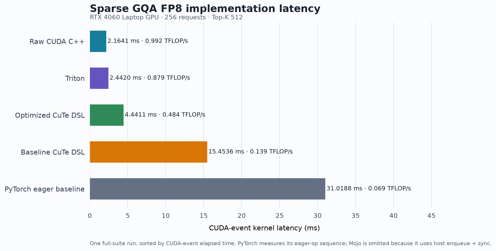
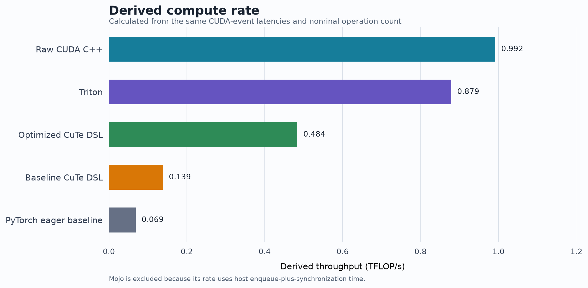
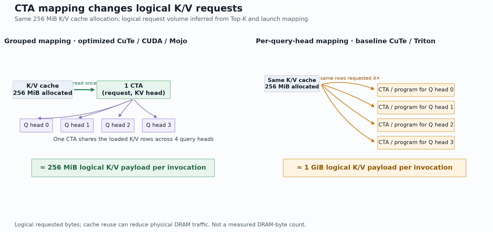
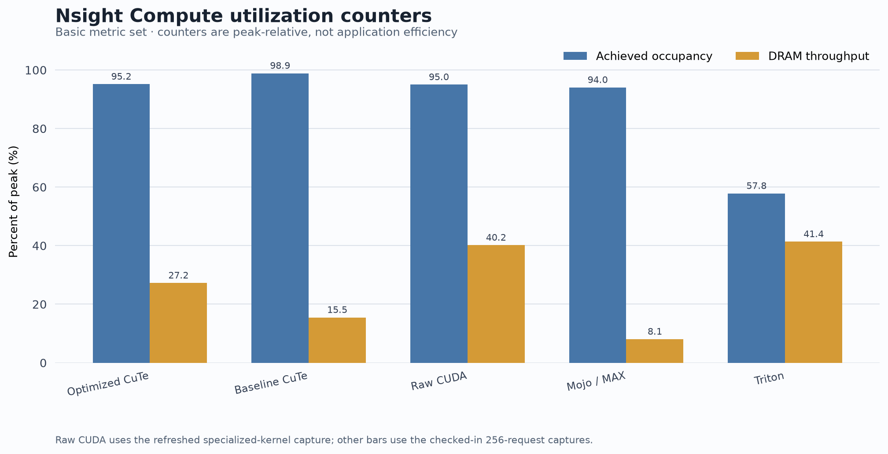

# Sparse Paged GQA FP8 Kernels on SM89

**Author:** Ammar Alnagar

**Target used for the reported run:** NVIDIA GeForce RTX 4060 Laptop GPU, compute capability 8.9 (Ada Lovelace), 8 GiB VRAM

**PyTorch reference environment:** PyTorch 2.14.1+cu130 (built with CUDA 13.0)

**Current test workload:** 256 requests, 32 query heads, 8 KV heads, head dimension 128, Top-K 512, BF16 query/gate/output, FP8 E4M3FN K/V cache, page size 16, and 32 pages per request.

This report describes the implementations and the larger test shape now configured in the sources. Focused Nsight Compute captures were collected on the RTX 4060 Laptop GPU for the five fused GPU kernels at the 256-request shape. The eager PyTorch baseline is a sequence of framework operations, not one kernel. NCU durations are profiler-instrumented and are not normal benchmark latencies. The older timing figures below are retained only as historical results from the 64-request shape.

## Implementations

- [`sm89_cutedsl.py`](sm89_cutedsl.py): optimized CuTe DSL implementation. One 128-thread CTA handles one request and one KV head; each warp handles one of the four query heads sharing that KV head.
- [`backup.py`](backup.py): CuTe DSL comparison kernel. One CTA handles one request and one query head, and its four warps cooperate on a 128-element dot product using shared memory and block barriers.
- [`sm89_torch.py`](sm89_torch.py): vectorized eager PyTorch baseline. It gathers each selected K/V row once per KV head, then uses batched matmul, softmax, and gating operations.
- [`sm89_triton.py`](sm89_triton.py): Triton implementation, one program per request/query head, with a 32-token loop tile and online softmax.
- [`sm89_cuda.cu`](sm89_cuda.cu): standalone CUDA C++ implementation with the same request/KV-head CTA mapping as optimized CuTe. It uses inline PTX for FP8-to-FP16 conversion and CUDA warp shuffles.
- [`sm89_mojo.mojo`](sm89_mojo.mojo): MAX GPU implementation with the same request/KV-head CTA mapping. Its loop tile is now 32 tokens, matching the other implementations. The source masks invalid tokens out of the online-softmax denominator and no longer reports hard-coded correctness values.

All six implementations compute the same intended operation for valid inputs: sparse scaled dot-product attention over selected logical token indices, followed by a sigmoid gate. The PyTorch eager baseline, CuTe, and Triton use the same randomized BF16/FP8 inputs and compare against the shared reference. CUDA and Mojo use constant fixtures and check every output against the closed-form BF16(0.05) result; these checks exercise the output path but do not cover randomized inputs.

## Workload and math

The current synthetic setup uses 256 requests × 32 pages/request × 16 tokens/page, with 8 KV heads and 128 values per head. Since 32 pages cover Top-K 512, this removes the prior allocation of 512 pages per request while preserving the selected-token workload. The physical K cache and V cache each contain:

`256 × 32 × 16 × 8 × 128 = 134,217,728` FP8 bytes (128 MiB).

Together they occupy 256 MiB, before query, output, metadata, allocator overhead, and temporary allocations. The selected Top-K is 512 per request. Indices select the first 512 logical tokens and the block table maps each request to its own contiguous physical pages.

The grouped CuTe/CUDA/Mojo launch has 256 × 8 = 2,048 CTAs. Baseline CuTe and Triton each launch 256 × 32 = 8,192 CTAs. These provide substantially more independent blocks than the previous 512/2,048-block setup.

For request `r`, query head `h`, and its KV head `g = floor(h / 4)`, the kernel computes scores from `Q[r,h] · (K[token,g] × k_scale) / sqrt(128)`, normalizes across the selected tokens, accumulates the corresponding scaled values, and multiplies each output element by `sigmoid(gate[r,h])`. The query/key and value reductions use float32 accumulators; output is stored as BF16.

The optimized CuTe and CUDA kernels fold `k_scale / sqrt(D) × log2(e)` into the score scale so that softmax exponentials use base 2. They accumulate unscaled V values and apply `v_scale` once in the final normalization. The baseline multiplies `v_scale` into each loaded V value. These transformations are algebraically equivalent for finite inputs, subject to floating-point rounding.

The nominal operation count used by the scripts is `4 × B × TopK × Hq × D` FLOPs: multiply-add work for QK and probability-weighted V. This is 2,147,483,648 FLOPs for the current 256-request shape and 536,870,912 FLOPs for the historical 64-request shape. TFLOP/s values use this convention and are derived rates, not hardware counters.

## Kernel organization in the source

### Optimized CuTe DSL and CUDA

Both use a grid of `[256, 8, 1]` and 128 threads per CTA. Four warps correspond to the four query heads in a GQA group. Each lane owns four adjacent dimensions (`4 × lane + {0,1,2,3}`), so one warp covers all 128 dimensions of one query head. It computes a four-element partial dot product and reduces it across 32 lanes with five butterfly shuffles. This avoids cross-warp reduction and shared memory for QK.

The token loop resolves a logical token into page and offset, looks up the physical page in the block table, loads K and V, updates the online softmax maximum/normalizer, and updates four per-lane output accumulators. The CUDA implementation explicitly packs four FP8 bytes into a 32-bit load and uses `cvt.rn.f16x2.e4m3x2`; the CuTe implementation indexes FP8 values through CUTLASS tensor wrappers. The source establishes these load/conversion choices; it does not by itself establish a particular cycle count or prove that a given instruction is the performance bottleneck.

### Baseline CuTe DSL

The baseline launch grid is `[256, 32, 1]`, with one CTA per query head. The four warps split the 128 dimensions and use shared memory plus block synchronization to combine their partial dot products. This repeats K/V work for query heads that share a KV head and launches four times as many CTAs as the grouped mapping (8,192 instead of 2,048).

### Triton

Triton launches one program per `(request, query head)` (8,192 programs). Each program processes Top-K in 32-token blocks, loads that head's query and the corresponding KV head's paged K/V rows, and maintains online-softmax state before writing its output row. It shares the CuTe test input and PyTorch reference, but repeats K/V loads across the four query heads in each GQA group.

### Mojo / MAX

Mojo also launches `[256, 8, 1]` with 128 threads per CTA and maps a warp to a query head. Its source uses `BLOCK_N = 32`, `unsafe_load[width=4]` for vector elements, and a compile-time five-step shuffle reduction. Invalid indices are skipped in the online-softmax state. The benchmark uses `perf_counter_ns` around 100 enqueues followed by `ctx.synchronize()`, so its reported interval includes host/runtime enqueue cost as well as GPU execution. It is labeled enqueue-plus-sync wall time and is not directly comparable to CUDA-event kernel timing. Its constant-input output is checked against BF16(0.05).

## Current 256-request benchmark run

The following run was collected with `python3 run_all.py` on the RTX 4060 Laptop GPU. Fused CuTe, Triton, and CUDA kernels use CUDA events. PyTorch eager timing measures its sequence of PyTorch operations with CUDA events; its wall-clock E2E value also includes framework dispatch. Mojo reports host wall time around enqueueing and synchronization. The E2E columns do not represent a common timing interval.

| Speed rank | Implementation | Kernel / timed interval | E2E reported | Derived rate | Validation |
|---:|---|---:|---:|---:|---|
| 1 | Raw CUDA C++ | 2.1641 ms | 2.164 ms | 0.992 TFLOP/s | PASS (fixture) |
| 2 | Triton | 2.4420 ms | — | 0.879 TFLOP/s | PASS |
| 3 | Optimized CuTe DSL | 4.4411 ms | 29.330 ms | 0.484 TFLOP/s | PASS |
| 4 | Baseline CuTe DSL | 15.4536 ms | 38.795 ms | 0.139 TFLOP/s | PASS |
| 5 | PyTorch eager baseline | 31.0188 ms | 27.032 ms | 0.069 TFLOP/s* | PASS |
| — | Mojo / MAX | 12.985 ms enqueue+sync | — | 0.165 TFLOP/s† | PASS (fixture) |





Raw CUDA had the lowest measured interval in this run, ahead of Triton. PyTorch eager uses the shared randomized input and reference; CUDA and Mojo passed their constant-fixture checks, which are narrower than the randomized reference comparison. The PyTorch event time spans many eager ATen operations, including gaps while Python dispatches them, so its speed rank is an implementation-level baseline rather than one fused-kernel comparison. Timings vary across runs; the table records one execution of the all-kernels command. The comparison summary reports pass/fail and does not reprint per-element max error.

`*` PyTorch eager's nominal rate uses CUDA-event elapsed time for its multi-operation sequence; its E2E column is the wall-clock average including dispatch and final synchronization. `†` Mojo's derived rate uses enqueue-plus-synchronization wall time, so it is not a GPU-only throughput. CUDA and Mojo fixture checks compare every output element with the analytically expected BF16(0.05) value.

### Speed order and data movement

The measured order is **raw CUDA → Triton → optimized CuTe → baseline CuTe → PyTorch eager**. Their derived rates were **0.992 → 0.879 → 0.484 → 0.139 → 0.069 TFLOP/s**, respectively. Relative to optimized CuTe, this run measured raw CUDA 2.05× faster and Triton 1.82× faster; baseline CuTe was 3.48× slower. Raw CUDA was 1.13× faster than Triton (`2.4420 / 2.1641`). PyTorch eager took 31.0188 ms by CUDA events and 27.032 ms by wall time in this run. Its event interval measures an eager op sequence and is included as the framework baseline. Mojo remains unranked because its timing uses a different host-side method. These are one-run measurements, and timings vary across runs.

The K/V cache allocation is **256 MiB** (128 MiB each for K and V). Each query head's warp/program processes a 128 KiB K/V slice for its 512 selected tokens. The four fused custom kernels request about **1 GiB of logical K/V payload per invocation**: grouped kernels still issue per-warp K/V loads, and per-query-head kernels each load the corresponding rows. Grouping reduces CTA count from 8,192 to 2,048 but does not share these loads. The PyTorch eager baseline gathers each selected K/V row once per KV head and reuses that gathered tensor across the four query heads, for about **256 MiB of logical K/V payload**, with much larger temporary FP32 tensors. These are logical requested bytes, not measured DRAM bytes; cache reuse can reduce physical traffic. Q and output each occupy about 2 MiB, while gate and index/block-table metadata are smaller.





The RTX 4060 Laptop GPU has 24 SMs. All fused kernels launch enough CTAs for multiple waves, but their mapping and generated work differ. Triton's capture reports 86.31% SM throughput and 41.35% DRAM throughput, with 72 registers/thread and 57.81% achieved occupancy. These counters indicate strong utilization for this implementation but do not isolate a single cause. Raw CUDA and optimized CuTe use the grouped mapping, reducing CTA count while still issuing duplicate warp-level K/V loads. The baseline's per-query-head CTA mapping adds shared-memory cross-warp reduction and barriers; it has high occupancy but lower measured throughput. The utilization chart compares these peak-relative profiler counters; it does not include the PyTorch eager sequence as a single kernel.

### Raw CUDA follow-up

The CUDA path now specializes page-index calculation for the fixed 16-token pages used by this benchmark, replacing runtime integer division and remainder with compile-time constant arithmetic. Other page sizes retain a generic kernel fallback. A direct before/after run measured 3.1011 ms versus 3.0588 ms (about 1.4% faster) with validation passing in both runs. This is a small single-run gain and should be treated as tentative until repeated measurements; the source review found no low-risk change likely to remove the larger serial online-softmax loop or duplicate per-warp K/V loads.

## Historical 64-request benchmark run

The following values are transcribed from the earlier 64-request run. They do not measure the current 256-request configuration. CuTe and CUDA report CUDA-event kernel timing; their E2E columns are the scripts' separate end-to-end measurements. The old Mojo timing is host wall-clock time around enqueueing and synchronization.

| Implementation | Kernel / timed interval | E2E reported | Derived throughput | Printed validation |
|---|---:|---:|---:|---|
| Optimized CuTe DSL | 0.7933 ms (793.3 µs) | 59.512 ms | 0.677 TFLOP/s | max error 0.000004, PASS |
| Baseline CuTe DSL | 2.5078 ms (2507.8 µs) | 61.272 ms | 0.214 TFLOP/s | max error 0.00000, PASS |
| Raw CUDA C++ | 1.0042 ms (1004.2 µs) | 1.004 ms | 0.535 TFLOP/s | max error 0.000004, PASS |
| Mojo / MAX | 2.5402 ms (2540.2 µs) | 2.5402 ms | 0.211 TFLOP/s | old source printed PASS (not verified)* |

`*` The historical Mojo source printed validation values without calculating them; validation was not checked for that old result. The current source checks every output element against the closed-form fixture. The historical timing includes runtime enqueue overhead, so the table does not support a direct pure-kernel speed ranking for Mojo.

For that old shape, optimized CuTe was about **3.16× faster** than the baseline (`2.5078 / 0.7933`). Raw CUDA was about **2.50× faster** than baseline and about **1.27× slower** than optimized CuTe in that run. These ratios do not establish performance at 256 requests.

The historical `nvidia-smi` snapshot reported driver 595.91.07, CUDA 13.2, GPU memory capacity 8,188 MiB, and 76 MiB in use after those scripts exited. This was a post-run idle snapshot, not a measurement of each process's peak allocation.

## Current Nsight Compute profiles

The five fused GPU kernels were captured with Nsight Compute and the `basic` metric set. The matching 256-request reports are checked in; `qsa_sm89_raw_cuda_final.ncu-rep` is the refreshed capture for the specialized CUDA kernel. The PyTorch eager baseline is an ATen operation sequence and is not represented as one kernel in this table.

| Kernel | Grid CTAs | NCU duration* | Achieved occupancy | Registers/thread | Waves/SM | SM throughput | Memory throughput | DRAM throughput |
|---|---:|---:|---:|---:|---:|---:|---:|---:|
| Optimized CuTe | 2,048 | 4.013 ms | 95.15% | 38 | 7.11 | 75.19% | 69.20% | 27.23% |
| Baseline CuTe | 8,192 | 13.725 ms | 98.86% | 40 | 28.44 | 70.13% | 70.13% | 15.46% |
| Raw CUDA (specialized) | 2,048 | 2.840 ms | 94.98% | 35 | 7.11 | 74.92% | 59.00% | 40.16% |
| Mojo / MAX | 2,048 | 13.824 ms | 94.01% | 38 | 7.11 | 89.96% | 20.10% | 8.05% |
| Triton | 8,192 | 2.651 ms | 57.81% | 72 | 48.76 | 86.31% | 86.31% | 41.35% |

The device has 24 SMs and all five fused kernels launch enough blocks for multiple waves. Achieved occupancy ranges from 57.81% to 98.86%; occupancy alone does not predict latency. The PyTorch eager sequence is not represented as one Nsight kernel row. Cache behavior, instruction mix, reduction strategy, and launch overhead also affect results.

`*` NCU replays launches while collecting metrics; these instrumented durations are not directly comparable to the CUDA-event timings in the benchmark table. Throughput percentages are NCU's peak-relative counters, not percentages of application-level useful work.

## Historical saved Nsight Compute captures

The three original `.ncu-rep` files in the repository are older captures of the 64-request shape. Reading their recorded metrics with Nsight Compute gives:

| Capture | Grid | Duration | L1/TEX hit rate | Registers/thread | Dynamic shared memory/block |
|---|---:|---:|---:|---:|---:|
| `qsa_sm89_baseline.ncu-rep` | 64 × 32 CTAs | 3.41 ms | 49.79% | 40 | 16 B |
| `qsa_sm89_cutedsl.ncu-rep` | 64 × 8 CTAs | 1.12 ms | 93.90% | 38 | 0 B |
| `qsa_sm89_raw_cuda.ncu-rep` | 64 × 8 CTAs | 1.00 ms | 79.29% | 34 | 0 B |

These historical reports support the observed differences in CTA mapping, register count, shared-memory allocation, and the recorded L1/TEX hit rates for those specific captures. They do not include a Mojo capture. The reports also show equal grid/block dimensions for optimized CuTe and CUDA, and an L1/TEX hit rate that differs between those captures; therefore the hit rate should not be presented as identical across implementations or used alone to explain runtime. These artifacts are not profiles of the current 256-request shape.

The older values previously presented as Mojo NCU metrics, including estimated hit rates, bandwidth, register counts, barrier counts, and IPC, are not backed by a Mojo Nsight report in this repository and have been removed. Likewise, claims about exact cycle savings, bus burst utilization, compiler scheduling superiority, and causal attribution of the speed difference are not established by the available source and reports.

## Benchmark interpretation and limits

- In the historical run, the CuTe event times are the closest pure-device measurements in the supplied log. The separately reported CuTe E2E times are much larger, indicating substantial host/runtime work in that path; they should not be conflated with kernel execution time.
- CUDA's E2E value in that historical run matches its kernel value at the displayed precision. This does not mean the other scripts measure the same timing interval.
- Mojo's benchmark interval includes repeated `enqueue_function` submissions and a final synchronization. The Mojo Nsight report provides hardware counters, but its replay duration is instrumented and is not directly comparable to CUDA-event timings.
- The scripts use synthetic data and a fixed Top-K selection. They demonstrate this workload and implementation, not end-to-end model serving performance or an adaptive QSA selection strategy.
- The displayed latency and derived throughput are measurements from the supplied run and hardware/software state; they are not guaranteed results on another machine or run.

## Reproduction commands

Run all six implementations and print their comparison table:

```bash
python3 run_all.py
```

Run individual implementations if needed:

```bash
python3 sm89_cutedsl.py
python3 backup.py
python3 sm89_torch.py
cudarun sm89_cuda.cu
mojo sm89_mojo.mojo
```

Recreate the focused CuTe capture with:

```bash
ncu --set basic --kernel-name-base function --kernel-name regex:qsa_sm89_kernel \
  --target-processes all --export qsa_sm89_cutedsl_256 \
  .venv/bin/python sm89_cutedsl.py --profile
```

The current filtered captures include `qsa_sm89_baseline_256.ncu-rep`, `qsa_sm89_raw_cuda_final.ncu-rep`, `qsa_sm89_mojo_256.ncu-rep`, and `qsa_sm89_triton_256.ncu-rep`. Open current or historical reports in Nsight Compute with `ncu-ui <report>.ncu-rep`. The three original reports are historical 64-request captures.
